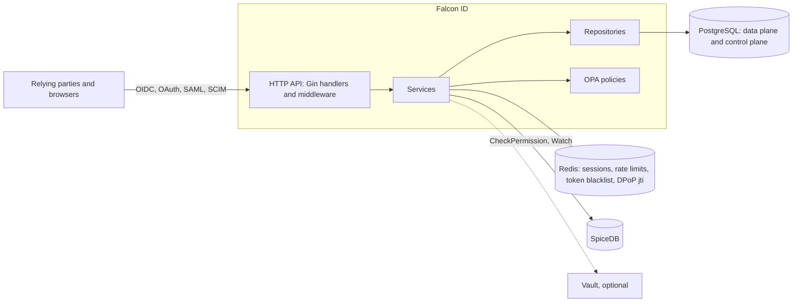

# Falcon ID

[](https://github.com/dogukanturhal/falcon-id/actions/workflows/ci.yml)
[](https://pkg.go.dev/github.com/dogukanturhal/falcon-id)
[](LICENSE)
[](https://scorecard.dev/viewer/?uri=github.com/dogukanturhal/falcon-id)

A multi-tenant OpenID Connect and OAuth 2.x identity provider in Go, with
SAML, SCIM, WebAuthn and adaptive MFA, where authorization decisions come from
SpiceDB.

## Who it is for

Teams building a multi-tenant SaaS who want the identity provider to know about
tenants from the start (realms, per-tenant SAML and SCIM, per-tenant roles)
and want authorization expressed as relationships in SpiceDB rather than as
role strings in tokens. It is also meant as something to read: the OAuth
profile work (PAR, DPoP, JAR, RFC 9207) is in plain Go with tests.

It is young. If you need a certified, battle-tested server today, read
"Status and limitations" and "How it compares" before choosing it.

## Features

Each item below exists in the code today. "Exists" is not "finished"; the
status section lists what is partial.

**OAuth 2.x and OpenID Connect**

- Discovery (`/.well-known/openid-configuration`) and JWKS.
- Authorization code flow with PKCE (S256 only). PKCE is required for public
  clients and clients flagged `RequirePKCE`.
- Refresh tokens with rotation, a short reuse grace window, and revocation of
  the whole token family when a rotated token is replayed.
- Client credentials and token exchange (RFC 8693).
- Token introspection (RFC 7662) and revocation (RFC 7009).
- Pushed authorization requests (RFC 9126), opt-in per client.
- DPoP (RFC 9449) at the token endpoint and on resource routes, with a Redis
  `jti` replay cache that fails closed.
- JWT-secured authorization requests (`request=`), RS256/384/512 only, and the
  RFC 9207 `iss` response parameter.
- RP-initiated logout, back-channel logout (provider side and an RP-side
  receiver), a front-channel logout service, and Shared Signals (SSF discovery
  and stream management, CAEP event emission through an outbox).

**Federation and provisioning**

- SAML 2.0 identity provider (`/saml/:tenant_id/{metadata,sso,slo}`) and SAML
  service provider endpoints.
- SCIM 2.0 server (`/scim/v2`).
- LDAP / Active Directory connector code (not exercised by the quickstart).
- Social login federation service.

**Authentication**

- WebAuthn (passkeys), TOTP, push MFA and magic links.
- Risk scoring, adaptive MFA and conditional access rules.
- Server-rendered login and consent pages (`internal/templates`).

**Authorization and operations**

- SpiceDB for permission checks and a Watch stream that invalidates the Redis
  permission cache. The schema is in `deploy/helm/spicedb-schema/files/spicedb.zed`.
- OPA policies for ABAC rules (`policies/pdp`).
- Realms with tenants inside them, Postgres row-level security policies in the
  migrations, per-tenant roles, groups, separation-of-duties checks and
  just-in-time platform elevation.
- Hash-chained audit records, rate limiting, optional Vault integration for
  secrets, Prometheus metrics and OpenTelemetry tracing.
- A `falcon` CLI (`cmd/falcon`) and small operator tools under `cmd/`.

## Quickstart

This gets the dependencies running, loads the SpiceDB schema and runs the unit
tests. It does not give you a working identity provider yet: the base Postgres
schema is missing from this repository (see the first item under "Status and
limitations"). Needs `docker` and Go (the version in `go.mod`).

```sh
git clone https://github.com/dogukanturhal/falcon-id && cd falcon-id
cp .env.example .env

# 1. Postgres (with the control-plane database), Redis, and SpiceDB with an
#    in-memory datastore
docker compose up -d

# 2. load the authorization schema into SpiceDB
SPICEDB_TOKEN=falcon-dev-preshared-key go run ./schema -schema-only

# 3. unit tests; the ones that need a real Postgres skip unless
#    TEST_DATABASE_URL is set
go test ./...
```

`docker compose --profile app up --build` also builds and starts the service
itself on port 8010, using the settings in `.env`. Against an empty database it
will not finish its start-up bootstrap, for the reason above.

### Request shapes

The authorization-code-plus-PKCE exchange looks like this against a running
instance. These shapes are taken from the handlers in
`internal/handlers/oauth_provider_handler.go`; I have not run them end to end
from a fresh checkout, because of the missing schema.

```sh
VERIFIER=$(openssl rand -base64 48 | tr -d '=+/' | cut -c1-64)
CHALLENGE=$(printf %s "$VERIFIER" | openssl dgst -sha256 -binary | openssl base64 -A | tr '+/' '-_' | tr -d '=')

# open in a browser; you are sent to /oauth/login (HTML form), then back with ?code=...
echo "http://localhost:8010/oauth/authorize?response_type=code&client_id=$CLIENT_ID\
&redirect_uri=$REDIRECT_URI&scope=openid&state=xyz&nonce=abc\
&code_challenge=$CHALLENGE&code_challenge_method=S256"

curl -s http://localhost:8010/oauth/token \
  -d grant_type=authorization_code -d code="$CODE" \
  -d redirect_uri="$REDIRECT_URI" -d code_verifier="$VERIFIER" \
  -d client_id="$CLIENT_ID" -d client_secret="$CLIENT_SECRET"
```

Clients are created with `POST /api/v1/admin/oauth-clients`, which needs an
admin role and a recent MFA step-up. A first admin user is created at start-up
when `FALCON_ADMIN_EMAIL` and `FALCON_ADMIN_PASSWORD` are both set.

## How it compares

This is from memory of each project's documentation; check their sites for
current certification status and features.

- **Keycloak** is the mature, widely deployed choice, with a large admin UI,
  many protocol options and OpenID certification. It is Java and has a heavier
  footprint. Falcon ID is smaller and Go, ties authorization to SpiceDB, and
  has a tenant model built into its data layer. It has far less production
  mileage and no certification.
- **Ory Hydra** (with Kratos for accounts) is a certified OAuth/OIDC server
  that deliberately ships without login and consent UI. Falcon ID bundles the
  login, MFA, SAML and SCIM pieces in one service, which is simpler to run and
  less composable.
- **ZITADEL** is the closest in scope: Go, multi-tenant, certified, with a
  hosted offering. Choose it if you want that maturity. Falcon ID's difference
  is the SpiceDB-based authorization and a codebase small enough to read.
- **Hosted providers** (Auth0, Okta, Entra ID) remove the operations burden.
  You trade that for data location control and per-user pricing.

## Status and limitations

Verified against the code in this repository.

- **The base database schema is not here.** The tables for users, tenants,
  realms and OAuth clients are created in our deployment by a Keystone
  `SchemaDefinition` that is not part of this repository. `internal/migrations`
  holds the incremental changes only. Until a baseline is published, the
  service cannot be started from a clean checkout, and Postgres-backed tests
  bring their own DDL.
- **Not FAPI 2.0 certified, and the OpenID Foundation conformance suite was
  not run.** There is no FAPI profile switch. What exists is
  `internal/services/oauth_provider_service_fapi2_test.go`, which calls itself
  a FAPI 2.0 Baseline self-conformance suite: 12 unit tests that pin
  settings the Baseline asks for (PAR advertised, S256, `iss` supported, `code`
  only, no implicit or password grants, no `none` or HS algorithms in
  discovery). It is a regression check against our own discovery document and
  validation code, not evidence of conformance, and it does not cover the
  gaps listed below.
- **DPoP is partial.** The original key binding is not carried through refresh
  token rotation: any valid proof is accepted on refresh. There is no
  server-issued `DPoP-Nonce`.
- **Client authentication.** PAR and the token endpoint accept a client secret
  (Basic or form) or `tls_client_auth` read from a forwarded client-certificate
  header. `private_key_jwt` is not implemented. PKCE is optional for
  confidential clients.
- **Certificate-bound access tokens (RFC 8705) are not wired.** Discovery says
  so.
- **Not implemented:** JARM, dynamic client registration, and the device
  authorization grant (a service exists but `/oauth/token` does not route to it).
- **SpiceDB is required in practice.** The authorization engine treats it as the
  sole decision source and fails closed without it. A log line about "RBAC/ABAC
  fallback" when `SPICEDB_ENABLED=false` is out of date.
- **Placeholders.** There are 101 `TODO` lines in 16 non-test Go files.
  `internal/handlers/stub_handlers.go` holds about 140 handlers that return
  empty 200 responses for platform-admin screens (storage, billing, network,
  compute, quotas, Cloudflare DNS), and about 60 places return 501, including
  parts of `application_handler.go` and tenant transfer. Tenant onboarding does
  not yet seed default roles or send the welcome email.
- **One maintainer, no tagged release, no stability promise.** Endpoints,
  settings and the SpiceDB schema can change.

## Architecture



Layout:

| Path | What is there |
|---|---|
| `cmd/` | The service entry point, route registration, start-up bootstrap, and the operator tools (`resetpw`, `migrate-spicedb`, `verify-spicedb`, `backfill-spicedb`, `migrate-user-realm`, `falcon` CLI) |
| `internal/handlers`, `internal/middleware` | HTTP layer |
| `internal/services` | Protocol and business logic (OAuth provider, SAML, SCIM, MFA, risk, authorization engine) |
| `internal/repositories`, `internal/migrations` | Postgres access and incremental SQL |
| `internal/templates` | Login, consent and WebAuthn enrolment pages |
| `pkg/` | Reusable pieces: `dpop`, `spicedb`, `config`, `crypto`, `redis`, `keys`, `hrn` |
| `policies/pdp` | OPA decision rules and their tests |
| `deploy/helm` | Helm charts, including the SpiceDB schema |
| `docs/` | Design notes: multi-tenancy, claims, integration guide, ADRs |

## License

AGPL-3.0-or-later. See [LICENSE](LICENSE). Contributions are accepted under the
same licence with a DCO sign-off; see [CONTRIBUTING.md](CONTRIBUTING.md).

## Security

Please report vulnerabilities privately; see [SECURITY.md](SECURITY.md).
