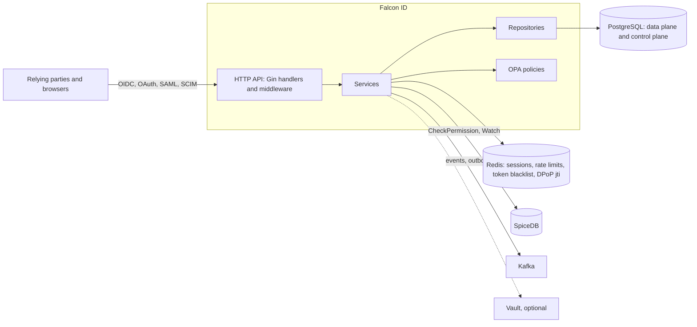

<p align="center">
  <picture>
    <source media="(prefers-color-scheme: dark)" srcset="docs/media/logo-dark.svg">
    <source media="(prefers-color-scheme: light)" srcset="docs/media/logo-light.svg">
    
  </picture>
</p>

# Falcon ID

**A multi-tenant OpenID Connect and OAuth 2.x identity provider in Go, with authorization decisions from SpiceDB.**

[](https://github.com/dogukanturhal/falcon-id/actions/workflows/ci.yml)
[](https://pkg.go.dev/github.com/dogukanturhal/falcon-id)
[](LICENSE)
[](https://scorecard.dev/viewer/?uri=github.com/dogukanturhal/falcon-id)

**Status:** pre-1.0. `docker compose up` starts a working server; it is not independently audited and not OpenID certified.

[Quickstart](#quickstart) · [Docs](docs/) · [Architecture](#architecture) · [Security](#security) · [Contributing](CONTRIBUTING.md)

It bundles SAML, SCIM, WebAuthn and adaptive MFA in one service, and models tenants (realms, per-tenant SAML and SCIM, per-tenant roles) in the data layer from the start.

## Who it is for

Teams building a multi-tenant SaaS who want the identity provider to know about
tenants from the start and want authorization expressed as relationships in
SpiceDB rather than as role strings in tokens. It is also meant as something to
read: the OAuth profile work (PAR, DPoP, JAR, RFC 9207) is in plain Go with
tests; see "Spec coverage".

If you need a certified, battle-tested server today, read "Status and
limitations" and "How it compares" before choosing it.

## Features

Each item below exists in the code today. "Exists" is not "finished"; the
status section lists what is partial.

**OAuth 2.x and OpenID Connect**

- Discovery (`/.well-known/openid-configuration`) and JWKS.
- Authorization code flow with PKCE (S256 only). PKCE is required for public
  clients and clients flagged `RequirePKCE`.
- Refresh tokens with rotation, a short reuse grace window, and revocation of
  the whole token family when a rotated token is replayed.
- Client credentials and token exchange (RFC 8693).
- Token introspection (RFC 7662) and revocation (RFC 7009).
- Pushed authorization requests (RFC 9126), opt-in per client.
- DPoP (RFC 9449) at the token endpoint and on resource routes, with a Redis
  `jti` replay cache that fails closed.
- JWT-secured authorization requests (`request=`), RS256/384/512 only, and the
  RFC 9207 `iss` response parameter.
- RP-initiated logout, back-channel logout (provider side and an RP-side
  receiver), a front-channel logout service, and Shared Signals (SSF discovery
  and stream management, CAEP event emission through an outbox).

**Federation and provisioning**

- SAML 2.0 identity provider (`/saml/:tenant_id/{metadata,sso,slo}`) and SAML
  service provider endpoints.
- SCIM 2.0 server (`/scim/v2`).
- LDAP / Active Directory connector code (not exercised by the quickstart).
- Social login federation service.

**Authentication**

- WebAuthn (passkeys), TOTP, push MFA and magic links.
- Risk scoring, adaptive MFA and conditional access rules.
- Server-rendered login and consent pages (`internal/templates`).

**Authorization and operations**

- SpiceDB for permission checks and a Watch stream that invalidates the Redis
  permission cache. The schema is in `deploy/helm/spicedb-schema/files/spicedb.zed`.
- OPA policies for ABAC rules (`policies/pdp`).
- Realms with tenants inside them, Postgres row-level security policies in the
  migrations, per-tenant roles, groups, separation-of-duties checks and
  just-in-time platform elevation.
- Hash-chained audit records, rate limiting, optional Vault integration for
  secrets, Prometheus metrics and OpenTelemetry tracing.
- A `falcon` CLI (`cmd/falcon`) and small operator tools under `cmd/`.

## Quickstart

Needs `docker` with Compose v2.24 or newer. Nothing else: the image is built
from this repository.

```sh
git clone https://github.com/dogukanturhal/falcon-id && cd falcon-id

# Postgres (schema loaded from hack/schema), Redis, an in-memory SpiceDB with
# the authorization schema written to it, and Falcon ID itself on :8010.
docker compose up -d --build --wait

curl -s http://localhost:8010/.well-known/openid-configuration
```

The last command returns the discovery document. Settings come from
`.env.example`; put overrides in `.env`. State lives in the `pgdata` volume
(SpiceDB is in memory and is re-seeded on each start); `docker compose down -v`
resets everything. The Postgres schema is loaded only into an empty volume. The
dev values are throwaways and must not be used anywhere real.

### Create a client and run authorization code with PKCE

The stack runs in standalone mode (`STANDALONE_MODE=true` in `.env.example`),
so no other services are needed. CI runs the steps below on every change
(`quickstart smoke test`). To get a service token, add this to `.env` and run
`docker compose up -d --force-recreate falcon-id`:

```sh
FALCON_PROVISIONER_CLIENT_ID=quickstart-provisioner
FALCON_PROVISIONER_CLIENT_SECRET=choose-a-long-random-secret
```

```sh
PROV_ID=quickstart-provisioner
PROV_SECRET=choose-a-long-random-secret   # the value you put in .env
curl -s -u "$PROV_ID:$PROV_SECRET" \
  -d grant_type=client_credentials -d scope=admin:oauth-clients \
  http://localhost:8010/oauth/token          # returns an access token

# a public client: PKCE is required, there is no secret
curl -s -X POST http://localhost:8010/api/v1/internal/oauth-clients \
  -H "Authorization: Bearer $TOKEN" -H 'Content-Type: application/json' \
  -d '{"name":"Quickstart app","grant_types":["authorization_code","refresh_token"],
       "response_types":["code"],"redirect_uris":["http://localhost:9999/callback"],
       "scopes":["openid","profile","email"],"is_public":true,"require_pkce":true,
       "logo_url":"https://example.com/logo.png"}'
```

Once a client exists, the authorization-code exchange is:

```sh
CLIENT_ID=...   # from the response above
REDIRECT_URI=http://localhost:9999/callback
VERIFIER=$(openssl rand -base64 48 | tr -d '=+/' | cut -c1-64)
CHALLENGE=$(printf %s "$VERIFIER" | openssl dgst -sha256 -binary | openssl base64 -A | tr '+/' '-_' | tr -d '=')

# open in a browser; you are sent to /oauth/login (HTML form), then back with ?code=...
echo "http://localhost:8010/oauth/authorize?response_type=code&client_id=$CLIENT_ID\
&redirect_uri=$REDIRECT_URI&scope=openid&state=xyz&nonce=abc\
&code_challenge=$CHALLENGE&code_challenge_method=S256"

curl -s http://localhost:8010/oauth/token \
  -d grant_type=authorization_code -d code="$CODE" \
  -d redirect_uri="$REDIRECT_URI" -d code_verifier="$VERIFIER" \
  -d client_id="$CLIENT_ID"
```

This part has not been run against a fresh checkout. Logging in also needs a
user (`FALCON_ADMIN_EMAIL` and `FALCON_ADMIN_PASSWORD` in `.env` create one at
start-up), and a new device can make the login page ask for MFA enrolment.

### Running without Docker

`docker compose up -d postgres redis spicedb spicedb-schema` starts only the
dependencies. Then `cp .env.example .env` and `go run ./cmd/` runs the server
on the host. `go test ./...` runs the unit tests; those that need a real
Postgres skip unless `TEST_DATABASE_URL` is set.

## How it compares

This is from memory of each project's documentation; check their sites for
current certification status and features.

- **Keycloak** is the mature, widely deployed choice, with a large admin UI,
  many protocol options and OpenID certification. It is Java and has a heavier
  footprint. Falcon ID is smaller and Go, ties authorization to SpiceDB, and
  has a tenant model built into its data layer. It has far less production
  mileage and no certification.
- **Ory Hydra** (with Kratos for accounts) is a certified OAuth/OIDC server
  that deliberately ships without login and consent UI. Falcon ID bundles the
  login, MFA, SAML and SCIM pieces in one service, which is simpler to run and
  less composable.
- **ZITADEL** is the closest in scope: Go, multi-tenant, certified, with a
  hosted offering. Choose it if you want that maturity. Falcon ID's difference
  is the SpiceDB-based authorization and a codebase small enough to read.
- **Hosted providers** (Auth0, Okta, Entra ID) remove the operations burden.
  You trade that for data location control and per-user pricing.

## Spec coverage

What the unit tests exercise today. This is a regression suite run in CI, not
a conformance result: the OpenID Foundation conformance suite has not been
run against this server, and nothing here is certified.

| Spec | Tests |
|---|---|
| PKCE (S256), PAR (RFC 9126) | [`oauth_par_service_test.go`](https://github.com/dogukanturhal/falcon-id/blob/main/internal/services/oauth_par_service_test.go) |
| JWT-secured authorization requests (JAR, `request=`) | [`oauth_provider_jar_test.go`](https://github.com/dogukanturhal/falcon-id/blob/main/internal/services/oauth_provider_jar_test.go) |
| DPoP (RFC 9449) | [`pkg/dpop`](https://github.com/dogukanturhal/falcon-id/blob/main/pkg/dpop/dpop_test.go) (proof validation), [`middleware/dpop_test.go`](https://github.com/dogukanturhal/falcon-id/blob/main/internal/middleware/dpop_test.go) (resource routes), [`oauth_provider_service_dpop_test.go`](https://github.com/dogukanturhal/falcon-id/blob/main/internal/services/oauth_provider_service_dpop_test.go) (`cnf.jkt` in tokens) |
| `iss` response parameter (RFC 9207), discovery settings pinned by the FAPI 2.0 Baseline | [`oauth_provider_service_fapi2_test.go`](https://github.com/dogukanturhal/falcon-id/blob/main/internal/services/oauth_provider_service_fapi2_test.go) (12 tests) |
| Refresh rotation, reuse detection, family revocation | [`oauth_provider_service_refresh_reuse_test.go`](https://github.com/dogukanturhal/falcon-id/blob/main/internal/services/oauth_provider_service_refresh_reuse_test.go) |
| Token exchange (RFC 8693) | [`oauth_provider_service_token_exchange_test.go`](https://github.com/dogukanturhal/falcon-id/blob/main/internal/services/oauth_provider_service_token_exchange_test.go) |
| Introspection (RFC 7662), revocation (RFC 7009) | `TestOAuthHandler_Introspect`, `TestOAuthHandler_Revoke` in [`oauth_provider_handler_test.go`](https://github.com/dogukanturhal/falcon-id/blob/main/internal/handlers/oauth_provider_handler_test.go) |
| Back-channel logout | [`backchannel_logout_receiver_test.go`](https://github.com/dogukanturhal/falcon-id/blob/main/internal/services/backchannel_logout_receiver_test.go), [`backchannel_logout_drainer_test.go`](https://github.com/dogukanturhal/falcon-id/blob/main/internal/services/backchannel_logout_drainer_test.go) |
| CAEP event emission | [`caep_emitter_test.go`](https://github.com/dogukanturhal/falcon-id/blob/main/internal/services/caep_emitter_test.go) |
| SAML signatures and assertions | [`internal/security`](https://github.com/dogukanturhal/falcon-id/blob/main/internal/security/saml_signature_verify_test.go), [`saml_service_test.go`](https://github.com/dogukanturhal/falcon-id/blob/main/internal/services/saml_service_test.go) |
| SCIM 2.0 | [`scim_service_test.go`](https://github.com/dogukanturhal/falcon-id/blob/main/internal/services/scim_service_test.go) |
| WebAuthn | [`webauthn_service_test.go`](https://github.com/dogukanturhal/falcon-id/blob/main/internal/services/webauthn_service_test.go) |

## Status and limitations

Checked against the code in this repository.

| Area | State |
|---|---|
| Maturity | Pre-1.0, one maintainer, no stability promise. Endpoints, settings and the SpiceDB schema can change. |
| Audit | Not independently audited. |
| Conformance | Not OpenID certified. The OpenID Foundation conformance suite has not been run, and there is no FAPI profile switch. `oauth_provider_service_fapi2_test.go` calls itself a FAPI 2.0 Baseline self-conformance suite, but it only pins settings in the server's own discovery document and validation code (PAR advertised, S256, `iss` supported, `code` only, no implicit or password grants, no `none` or HS algorithms). It is not evidence of conformance. |
| Base database schema | A schema-only snapshot for local and evaluation use is in `hack/schema`. Production schema in the maintainer's deployment comes from a Keystone `SchemaDefinition` and migration bundles that are not published, so the snapshot does not track individual migrations. `internal/migrations` holds incremental changes. |
| DPoP | Partial. The original key binding is not carried through refresh token rotation: any valid proof is accepted on refresh. No server-issued `DPoP-Nonce`. |
| Client authentication | PAR and the token endpoint accept a client secret (Basic or form) or `tls_client_auth` read from a forwarded client-certificate header. `private_key_jwt` is not implemented. PKCE is optional for confidential clients. |
| Certificate-bound access tokens (RFC 8705) | Not wired. Discovery says so. |
| Not implemented | JARM, dynamic client registration, and the device authorization grant (a service exists but `/oauth/token` does not route to it). |
| SpiceDB | Required in practice. It is the only source for relationship (ReBAC) checks; there is no local fallback, and those checks fail closed when SpiceDB is unavailable. OPA rules (ABAC) and per-tenant roles are evaluated in addition to it, not instead of it. A log line about "RBAC/ABAC fallback" when `SPICEDB_ENABLED=false` is out of date. |
| Placeholders | 100 `TODO` lines in 15 non-test Go files (outside `third_party/`). `internal/handlers/stub_handlers.go` holds 145 handler functions, most returning an empty 200 for platform-admin screens (storage, billing, network, compute, quotas, Cloudflare DNS). 23 places return 501 via `StatusNotImplemented`, including parts of `application_handler.go` and tenant transfer. Tenant onboarding does not yet seed default roles or send the welcome email. |

## Architecture



Layout:

| Path | What is there |
|---|---|
| `cmd/` | The service entry point, route registration, start-up bootstrap, and the operator tools (`resetpw`, `migrate-spicedb`, `verify-spicedb`, `backfill-spicedb`, `migrate-user-realm`, `falcon` CLI) |
| `internal/handlers`, `internal/middleware` | HTTP layer |
| `internal/services` | Protocol and business logic (OAuth provider, SAML, SCIM, MFA, risk, authorization engine) |
| `internal/repositories`, `internal/migrations` | Postgres access and incremental SQL |
| `internal/templates` | Login, consent and WebAuthn enrolment pages |
| `pkg/` | Reusable pieces: `dpop`, `spicedb`, `config`, `crypto`, `redis`, `keys`, `hrn` |
| `policies/pdp` | OPA decision rules and their tests |
| `hack/schema` | Schema-only SQL loaded by the compose quickstart |
| `deploy/helm` | Helm charts, including the SpiceDB schema |
| `docs/` | Design notes: multi-tenancy, claims, ADRs |

## Community

Questions and ideas: [GitHub Discussions](https://github.com/dogukanturhal/falcon-id/discussions). Bugs and concrete requests: issues. See [CONTRIBUTING.md](CONTRIBUTING.md).

## License

AGPL-3.0-or-later. See [LICENSE](LICENSE). Contributions are accepted under the
same licence with a DCO sign-off; see [CONTRIBUTING.md](CONTRIBUTING.md).

## Security

Report vulnerabilities privately through [GitHub private vulnerability reporting](https://github.com/dogukanturhal/falcon-id/security/advisories/new) or by email to dogukanturhal@hexxlock.com. Do not open a public issue. See [SECURITY.md](SECURITY.md).
